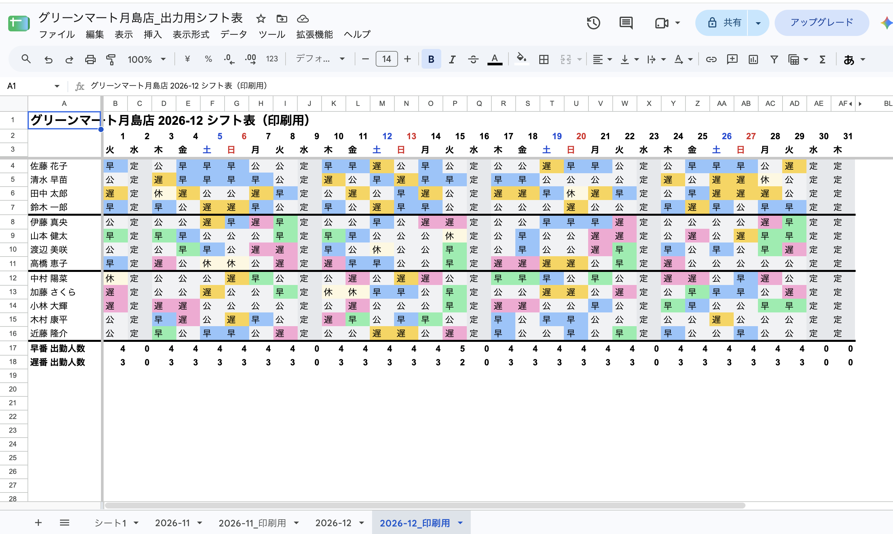
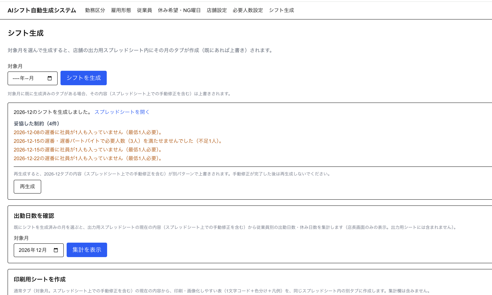
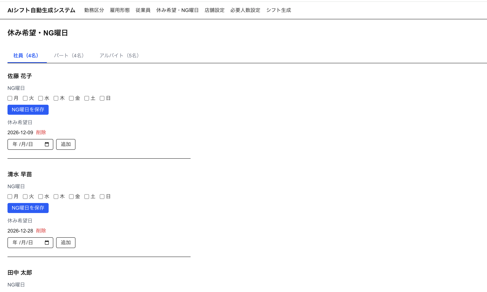

# AIシフト自動生成システム

アルバイト・パートを含む店舗スタッフのシフト表を、休み希望・雇用形態別ルール・必要人数を踏まえて自動生成するWebシステムです。生成結果はGoogleスプレッドシートに出力し、店長はそのままスプレッドシート上で手直しできます。

🔗 **デモ**: https://shift-scheduler-iota-red.vercel.app

## 特徴

- **外部LLM APIを使わない自動生成**: シフト生成はOpenAI等を使わず、制約充足問題（CSP）として解く独自アルゴリズム（貪欲法＋局所探索）のみで実装。コストをかけずに運用できます。
- **ハード制約は絶対に守る**: 休み希望・NG曜日、雇用形態別ルール（連勤上限・週稼働上限など）、日ごとの必要人数は必ず満たします。どうしても埋めきれない場合は「妥協した制約」としてログに残し、店長に提示します。
- **Googleスプレッドシート連携**: 生成結果は店舗ごとのスプレッドシートに自動出力。店長がセルを直接編集・ドロップダウンで修正すると、出勤人数の集計や印刷用シートの色分けも自動で追従します。
- **店長によるGoogleログイン**: Google OAuthでログインし、本人のGoogleアカウント配下にのみシフト表が作成されます。

## スクリーンショット

### 生成されたシフト表（Googleスプレッドシート）
希望休（本人申請）と自動割振休（システム割当）を色で区別し、勤務区分ごとの出勤人数も自動集計されます。



### シフト生成画面（妥協した制約のログ表示）
必要人数をどうしても満たせない日があった場合、どの制約をどう妥協したかを具体的に表示します。



### 雇用形態マスタ
雇用形態ごとに週の勤務日数・勤務時間の上限、連勤上限、月間目標時間、勤務区分ごとの必須配置人数などを設定できます。


### 休み希望・NG曜日の入力
従業員ごとに、恒常的なNG曜日と個別の休み希望日を登録できます。



## 技術スタック

- **フロントエンド**: Next.js (App Router) / TypeScript / Tailwind CSS
- **バックエンド**: Next.js Server Actions
- **DB**: Supabase（店舗・従業員・ルールなどのマスタ管理）
- **外部連携**: Google Sheets API / Google OAuth
- **テスト**: Vitest（209件超の単体テスト）
- **ホスティング**: Vercel

## シフト生成アルゴリズム

1. **貪欲法（Greedy）**: 日付順に、ハード制約（休み希望・NG曜日・雇用形態ルール）を満たせる従業員の中から必要人数を埋める。週内の残り供給と残り需要を日ごとに再計算し、週後半に不足が偏らないよう目標人数を按分する。
2. **局所探索（Local Search / 焼きなまし法）**: 貪欲法の結果に対し、勤務日数の公平性・月間目標時間の達成度をスコア化し、スワップ操作で改善を試みる。人数配置そのものは変えない。
3. **制約違反の検出**: 最終的な割り当てから独立して制約充足状況を再計算し、妥協した制約があればログとして店長に提示する。

詳細な要件は [要件定義書_AIシフト自動生成システム.md](./要件定義書_AIシフト自動生成システム.md) を参照してください。

## 開発

```bash
npm install
npm run dev       # 開発サーバー起動
npm run test      # テスト実行
npm run lint      # Lint
npx tsc --noEmit  # 型チェック
```

環境変数は `.env.local.example` を参考に `.env.local` を作成してください（Supabase・Google OAuthの各種キーが必要です）。
